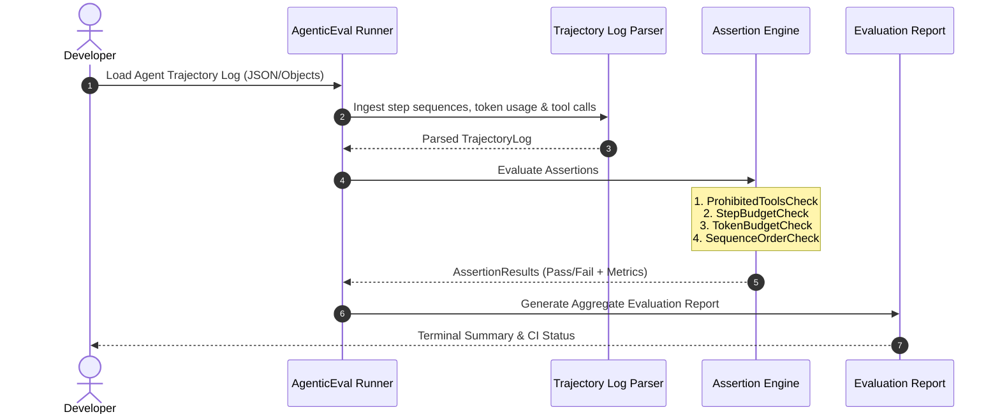

# AgenticEval Harness

[](https://github.com/kdmbhushan/agentic-eval-harness/actions/workflows/ci.yml)
[](LICENSE)
[](https://dotnet.microsoft.com/)

> **Spec-driven automated evaluation and regression testing harness for autonomous coding agents.**

This repository hosts the official reference implementation anchoring the technical deep-dive:  
🔗 **[Spec-Driven Agentic Engineering: Continuous Evaluation & Trajectory Verification](https://bhushankadam.dev/blog/spec-driven-agentic-development)** on [bhushankadam.dev](https://bhushankadam.dev).

---

## 🎯 Architecture & Trajectory Verification Flow

Modern AI coding agents generate multi-step decision trajectories comprising file reads, edits, tool invocations, and command executions. Traditional unit tests fail to evaluate intermediate decision paths, token budgets, or tool safety constraints.

`AgenticEval` provides deterministic trajectory assertion rules to evaluate agent reliability:



---

## 🚀 Key Capabilities

- **Prohibited Tool Protection**: Assert that autonomous agents never execute hazardous actions (e.g. destructive commands, secret leaks, raw DB drops).
- **Trajectory Step & Token Budgets**: Enforce step limits and token consumption budgets to eliminate infinite loops and high API costs.
- **Chronological Sequence Ordering**: Verify that agents follow proper engineering lifecycles (e.g., `specify -> clarify -> plan -> implement -> test`).
- **Zero Cloud Credentials Required**: Complete offline local testbed with mock trajectories and reproducible assertions.

---

## 🛠️ Quickstart

### Prerequisites
- [.NET 8.0 SDK](https://dotnet.microsoft.com/download/dotnet/8.0) or [.NET 9.0 SDK](https://dotnet.microsoft.com/download/dotnet/9.0)

### Run Demonstration Harness
```bash
dotnet run --project src/AgenticEval.Runner
```

### Run Automated Tests
```bash
dotnet test
```

---

## 📄 License
This project is licensed under the [MIT License](LICENSE).
